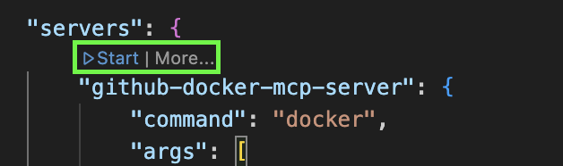

# GitHub MCP Server

A [Model Context Protocol](https://modelcontextprotocol.io/) (MCP) server implementation provided by GitHub. Check out the [README.md](https://github.com/github/github-mcp-server) in the github-mcp-server repository.

## Overview

The GitHub MCP Server connects AI tools directly to GitHub's platform. This gives AI agents, assistants, and chatbots the ability to read repositories and code files, manage issues and PRs, analyze code, and automate workflows — all through natural language interactions.

> **Note:** This server (`src/github`) and the GitHub Actions server (`src/gh-actions`) use the same Docker image (`ghcr.io/github/github-mcp-server:0.31.0`) but with different `GITHUB_TOOLSETS`:
> - **`default`** (this server): Covers GitHub standard tools (repositories, issues, pull requests, etc.)
> - **`actions,context`** (src/gh-actions): Covers GitHub Actions workflows and team context

### Limitations

- Be aware that you are using your own token and changes to repositories are made in your name.
- There is a read-only mode available; check the official [README.md](https://github.com/github/github-mcp-server) for details.
- The accuracy of results may vary depending on the LLM model used. For optimal performance, it is **recommended to use premium models such as Claude Sonnet**.

## Getting Started

### Prerequisites

- Docker
- [WSL setup](https://inside-docupedia.bosch.com/confluence/x/37HoYQ)
- Personal Access Token for GitHub
- GitHub Copilot Subscription

### MCP Client Integration

1. Integrate the MCP server with your VSCode GitHub Copilot by adding a configuration file `.vscode/mcp.json`. Use the provided [`mcp.json`](mcp.json) as a reference and replace all placeholders.
2. Start the Docker MCP server after adding `.vscode/mcp.json`.
3. See [`../README.md`](../README.md) for more on [Running MCP Servers](../README.md#running-mcp-servers-for-development).

### Configuration Details

Set the following environment variables (in `mcp.json`) for the MCP server:

| Variable | Description | Example |
|----------|-------------|---------|
| `GITHUB_PERSONAL_ACCESS_TOKEN` | GitHub Personal Access Token | `ghp_xxxxxxxxxxxxxxxxxxxx` |
| `GITHUB_HOST` | GitHub host URL for GitHub.com or GitHub Enterprise Server | `https://github.com` or `https://github.boschdevcloud.com` |
| `GITHUB_TOOLSETS` | Toolsets to enable | `default` |
| `GITHUB_DYNAMIC_TOOLSETS` | Enable dynamic toolset loading (1=enabled, 0=disabled) | `1` (recommended) |

> **Docker Image Version:** The current configuration uses `ghcr.io/github/github-mcp-server:0.31.0`. Available versions can be found on the [GitHub tags page](https://github.com/github/github-mcp-server/tags). Users may, at their own risk, use the latest version (`ghcr.io/github/github-mcp-server:latest`). However, the README and usage parameters must be verified against the specific version being used.

#### Dynamic Tool Selection

**Dynamic Tool Selection** is an intelligent feature that helps reduce tool confusion and improves AI model performance by enabling tools only when needed.

**Benefits:**
- **Reduces Tool Confusion**: Start with fewer core tools instead of overwhelming the AI with 100+ tools
- **Improves Performance**: Models make better decisions with fewer, more relevant options
- **Smart Discovery**: Tools are automatically discovered and enabled based on your requests
- **Better User Experience**: More accurate tool selection leads to fewer errors

**How it works:**
1. Start with core discovery tools
2. AI automatically detects which tools are needed based on your request
3. Only relevant tools are enabled for your workflow

Set `GITHUB_DYNAMIC_TOOLSETS=1` in `mcp.json` (enabled by default).

### Usage Examples

Once connected to VSCode GitHub Copilot chat or an MCP-compatible client, you can interact with GitHub using natural language. Try these examples:

- "List all open pull requests in repository owner/repo"
- "Show me the latest commits on branch main"
- "Create a new issue titled 'Bug: login fails' in repository owner/repo"
- "Review pull request #42 in repository owner/repo and add a comment"
- "Search for issues labeled 'enhancement' in repository owner/repo"
- "Get the content of file README.md from branch main"

### Features

The server provides the following MCP tool categories:

- **Repository Management**:
	- `search_repositories` - Search for GitHub repositories
	- `get_file_contents` - Get file or directory contents
	- `create_or_update_file` - Create or update a file in a repository
	- `push_files` - Push multiple files in a single commit

- **Issues**:
	- `create_issue` - Create a new issue
	- `list_issues` - List and filter repository issues
	- `update_issue` - Update an existing issue
	- `add_issue_comment` - Add a comment to an issue

- **Pull Requests**:
	- `create_pull_request` - Create a new pull request
	- `get_pull_request` - Get pull request details
	- `list_pull_requests` - List pull requests with filters
	- `merge_pull_request` - Merge a pull request
	- `create_pull_request_review` - Submit a review on a pull request

- **Code Search & Analysis**:
	- `search_code` - Search for code across repositories
	- `search_issues` - Search issues and pull requests
	- `search_users` - Search GitHub users

- **Branches & Commits**:
	- `create_branch` - Create a new branch
	- `list_commits` - List commits on a branch
	- `get_commit` - Get details of a specific commit

> **Note:** The above is a representative subset of available tools. For the full list of toolsets and individual tools, refer to the [GitHub MCP Server — Available Toolsets](https://github.com/github/github-mcp-server#available-toolsets).

### Troubleshooting

| Issue | Solution |
|-------|----------|
| Authentication errors | Verify `GITHUB_PERSONAL_ACCESS_TOKEN` is valid and has the required scopes |
| Read-only operation required | Enable read-only mode; check the official [README.md](https://github.com/github/github-mcp-server) |
| Dynamic tools not loading | Ensure `GITHUB_DYNAMIC_TOOLSETS=1` is set in `mcp.json` |
| Docker image not found | Verify Docker is running and the image `ghcr.io/github/github-mcp-server:0.31.0` is accessible |
| Unexpected or missing data | Refine your prompt or verify the token has access to the requested repository |

## Related Resources

- [Model Context Protocol](https://modelcontextprotocol.io/)
- [GitHub MCP Server](https://github.com/github/github-mcp-server)
- [GitHub Personal Access Token](https://docs.github.com/en/authentication/keeping-your-account-and-data-secure/managing-your-personal-access-tokens)
